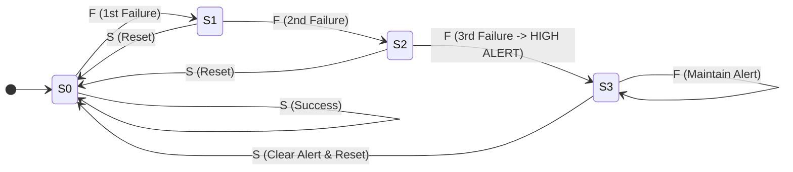

# Network Event Log Analyzer

A professional, full-stack cybersecurity web application built with **React.js, Node.js, Express.js, and MongoDB**.

This project bridges **Full Stack Web Development (MERN)**, **Computer Networks**, **Formal Language Regular Expressions**, and **Automata Theory (Finite State Machines)** to ingest, parse, validate, and detect security threats in network event logs in real time.

---

## 1. Project Introduction
Modern network infrastructures generate high volumes of connection telemetry. Analyzing authentication handshakes and identifying brute-force attacks require robust pattern-matching and stateful anomaly detection.

**Network Event Log Analyzer** evaluates network event logs formatted as:
```text
YYYY-MM-DD HH:MM:SS IP=IPv4 USER=username STATUS=SUCCESS/FAILED
```
The application performs lexical extraction using regular expressions, carries out semantic validation on network addresses and calendar timestamps, and feeds chronological connection attempts into a **Deterministic Finite State Machine (DFA)** to uncover multi-attempt brute-force intrusion patterns.

---

## 2. Project Objectives
- Ingest network event logs via drag-and-drop file upload (`.txt`, `.log`) or manual entry.
- Identify:
  1. Successful network connections.
  2. Failed connection attempts.
  3. Repeated failed attempts from identical IP addresses.
  4. Suspicious network activities and brute-force intrusion vectors.
  5. Invalid or malformed log entries with descriptive error diagnostics.
- Model multi-attempt failure tracking using a **Deterministic Finite State Machine ($S_0 \to S_1 \to S_2 \to S_3$)**.
- Automatically raise **HIGH severity security alerts** upon detecting 3 consecutive failures from an IP address.
- Persist parsed logs and threat telemetry in MongoDB with dynamic dashboard metrics and Chart.js visualizations.
- Provide an interactive FSM visualizer and simulator for educational demonstration.

---

## 3. Technologies Used

### Frontend:
- **React.js 18** (JavaScript, Hooks: `useState`, `useEffect`, `useMemo`, `useRef`)
- **Vite 5** (Fast frontend bundling and development server)
- **Axios** (REST API client)
- **React Router 6** (Single-page application navigation)
- **Chart.js & react-chartjs-2** (Interactive data visualization: Doughnut & Bar charts)
- **Lucide React** (Cybersecurity and telemetry iconography)
- **CSS3** (Responsive dark navy/blue cybersecurity dashboard theme)

### Backend:
- **Node.js 20+**
- **Express.js 4** (RESTful API architecture)
- **Multer** (Log file upload handling with size and extension validation)
- **CORS & Dotenv** (Cross-origin security & environment isolation)

### Database:
- **MongoDB** (NoSQL Document Store)
- **Mongoose 8** (Schema modeling, indexing, and aggregation pipelines)
- *Graceful fallback*: In-memory datastore adapter active when MongoDB is not running, ensuring immediate evaluation without crashing.

### Automata & Formal Languages:
- **Regular Expressions (Regex)** for lexical parsing.
- **Deterministic Finite Automaton (DFA)** for multi-failure state tracking.

---

## 4. Key Features

- **Dark Navy / Blue Cybersecurity Dashboard**: Real-time metric cards, success vs. failure charts, automata state distributions, suspicious IP leaderboards, and recent activity streams.
- **Dual Log Ingestion Engine**:
  - Drag-and-drop file upload supporting `.txt` and `.log` files (up to 2MB).
  - Manual textarea with live line counting and sample presets.
- **Strict Regular Expression & Semantic Validation**:
  - Validates IPv4 octets ($0 \le \text{octet} \le 255$) and disallows invalid leading zeros.
  - Validates calendar dates, leap years (February 29), and 24-hour clock constraints.
  - Displays rejected malformed entries separately with line-number diagnostics.
- **Deterministic Finite State Machine (FSM)**:
  - Tracks every IP address independently in chronological order.
  - Generates a HIGH severity alert upon the 3rd consecutive failure.
  - Suppresses duplicate alerts for continuous failure streams in alert state $S_3$.
  - Resets failure counter to $S_0$ immediately upon any successful login.
- **Interactive Automata Visualizer**:
  - Real-time animated State Transition Diagram (SVG).
  - Step-by-step simulator to manually test transitions ($F$ and $S$) with transition logging.
  - Complete formal definition and State Transition Table.
- **Searchable & Filterable Data Table**: Search by IP or username, filter by status, filter by FSM state, filter by date range, sort by columns, and navigate via pagination.
- **100% Automated Test Coverage**: Comprehensive unit test suite (`node --test`) covering Regex validation, leap-year boundaries, FSM transitions, and all academic test scenarios.

---

## 5. Project Folder Structure

```text
network-event-log-analyzer/
├── backend/
│   ├── controllers/
│   │   ├── alertController.js       # Security alert endpoints
│   │   ├── dashboardController.js   # Dynamic statistics & charts
│   │   └── logController.js         # Log analysis, query & delete
│   ├── middleware/
│   │   ├── errorHandler.js          # Centralized error handler
│   │   └── upload.js                # Multer file upload & validation
│   ├── models/
│   │   ├── NetworkLog.js            # Mongoose schema for logs
│   │   └── SecurityAlert.js         # Mongoose schema for alerts
│   ├── routes/
│   │   ├── alertRoutes.js           # /api/alerts
│   │   ├── dashboardRoutes.js       # /api/dashboard
│   │   └── logRoutes.js             # /api/logs
│   ├── tests/
│   │   ├── fsm.test.js              # Automata state transition tests
│   │   ├── probe-server.js          # API integration test probe
│   │   └── regex.test.js            # Regex & semantic validation tests
│   ├── utils/
│   │   ├── memoryStore.js           # In-memory store fallback
│   │   ├── parser.js                # Orchestrates regex + FSM
│   │   ├── regex.js                 # Log format regex & semantic validator
│   │   ├── sampleScenarios.js       # Test presets & sample logs
│   │   └── stateMachine.js          # Deterministic FSM implementation
│   ├── .env                         # Environment config
│   ├── .env.example                 # Environment template
│   ├── package.json                 # Backend dependencies & scripts
│   └── server.js                    # Express application entrypoint
├── documentation/
│   ├── fsm-diagram.svg              # Vector State Transition Diagram
│   ├── project-documentation.md     # Detailed academic project documentation
│   ├── state-transition-diagram.md  # Automata theory & Mermaid diagram
│   └── transition-table.md          # State transition matrix
├── frontend/
│   ├── src/
│   │   ├── components/
│   │   │   ├── DatabaseBanner.jsx   # Dynamic MongoDB status banner
│   │   │   ├── EmptyState.jsx       # Empty state placeholder
│   │   │   ├── LoadingSpinner.jsx   # Cybersecurity spinner
│   │   │   ├── Sidebar.jsx          # Collapsible navigation sidebar
│   │   │   └── TopBar.jsx           # Header with metrics & actions
│   │   ├── pages/
│   │   │   ├── DashboardPage.jsx    # Metrics, charts, recent logs
│   │   │   ├── FSMVisualizationPage.jsx # Interactive FSM simulator
│   │   │   ├── LogAnalysisPage.jsx  # Searchable & filtered logs table
│   │   │   ├── LogUploadPage.jsx    # File drag-and-drop & manual input
│   │   │   └── SecurityAlertsPage.jsx # Security threat incident viewer
│   │   ├── services/
│   │   │   └── api.js               # Axios REST client
│   │   ├── styles/
│   │   │   └── index.css            # Dark cybersecurity theme
│   │   ├── App.jsx                  # Root router & global state
│   │   └── main.jsx                 # React root mount
│   ├── index.html                   # HTML template
│   ├── package.json                 # Frontend dependencies & scripts
│   └── vite.config.js               # Vite config & API proxy
├── samples/
│   ├── attack-scenario-logs.txt     # Multi-IP brute force scenario
│   ├── malformed-logs.txt           # Test file with syntax & semantic errors
│   └── sample-logs.txt              # Standard academic sample logs
├── .env.example                     # Root env template
├── .gitignore                       # Git ignore file
├── package.json                     # Root orchestrator scripts
└── README.md                        # Project documentation
```

---

## 6. Installation Steps

### Prerequisites:
- **Node.js** (v18.0.0 or higher recommended)
- **npm** (v9.0.0 or higher)
- **MongoDB** (Optional: local Community Server or free MongoDB Atlas cluster)

### Clone & Install:
```bash
# 1. Clone repository
git clone https://github.com/your-username/network-event-log-analyzer.git
cd network-event-log-analyzer

# 2. Install backend dependencies
cd backend
npm install

# 3. Install frontend dependencies
cd ../frontend
npm install
```

---

## 7. MongoDB Configuration

The application is engineered to connect to MongoDB via Mongoose. If MongoDB is offline, it will automatically run in **In-Memory Demo Mode** and display an informative notice in the UI without crashing.

### Option A: Local MongoDB
1. Install MongoDB Community Server.
2. Start MongoDB:
   ```bash
   mongod --dbpath /data/db
   ```
3. Set your connection URI in `backend/.env`:
   ```env
   MONGODB_URI=mongodb://127.0.0.1:27017/network_log_analyzer
   ```

### Option B: Cloud MongoDB Atlas (Free Tier)
1. Sign up at [mongodb.com/cloud/atlas](https://www.mongodb.com/cloud/atlas).
2. Create a free shared cluster (M0) and create a database user.
3. Whitelist your IP address under Network Access (`0.0.0.0/0` for universal dev).
4. Copy the connection string and update `backend/.env`:
   ```env
   MONGODB_URI=mongodb+srv://<username>:<password>@cluster0.mongodb.net/network_log_analyzer?retryWrites=true&w=majority
   ```

---

## 8. How to Run Frontend

```bash
cd frontend
npm run dev
```
The frontend dev server runs at **http://localhost:5173**.

---

## 9. How to Run Backend

```bash
cd backend
npm start
```
The Express backend server runs at **http://localhost:5000**.

### Running Both Simultaneously (From Root):
```bash
# Terminal 1:
npm run server

# Terminal 2:
npm run client
```

---

## 10. Sample Input and Expected Output

### Standard Sample Input:
```text
2026-11-13 10:00:01 IP=192.168.1.10 USER=admin STATUS=SUCCESS
2026-11-13 10:01:01 IP=192.168.1.20 USER=root STATUS=FAILED
2026-11-13 10:01:10 IP=192.168.1.20 USER=root STATUS=FAILED
2026-11-13 10:01:20 IP=192.168.1.20 USER=root STATUS=FAILED
2026-11-13 10:02:00 IP=192.168.1.30 USER=user STATUS=SUCCESS
```

### Analysis Outcome:
1. **Line 1 (`192.168.1.10`)**: Connection `SUCCESS` $\implies$ State **$S_0$ (Normal)**.
2. **Line 2 (`192.168.1.20`)**: First failure $\implies$ State **$S_1$ (1st Failure)**.
3. **Line 3 (`192.168.1.20`)**: Second consecutive failure $\implies$ State **$S_2$ (2nd Failure)**.
4. **Line 4 (`192.168.1.20`)**: Third consecutive failure $\implies$ State **$S_3$ (Security Alert State)**.
   - **SECURITY ALERT TRIGGERED**:
     - IP Address: `192.168.1.20`
     - Severity: `HIGH`
     - Alert Type: `BRUTE_FORCE_SUSPECTED`
     - Message: *Suspicious activity: 3 consecutive failed login attempts detected from IP 192.168.1.20 (Target User: root).*
5. **Line 5 (`192.168.1.30`)**: Connection `SUCCESS` $\implies$ State **$S_0$ (Normal)**.

---

## 11. Finite State Machine (FSM) Explanation

The Finite State Machine is defined as a Deterministic Finite Automaton (DFA):

$$M = (Q, \Sigma, \delta, q_0, F)$$

- **States ($Q$):**
  - $S_0$: Normal State (0 consecutive failures).
  - $S_1$: First Failure Detected (1 failure).
  - $S_2$: Second Failure Detected (2 failures).
  - $S_3$: Security Alert State (3 or more consecutive failures).
- **Alphabet ($\Sigma$):**
  - $F$: Failed connection attempt (`STATUS=FAILED`).
  - $S$: Successful connection attempt (`STATUS=SUCCESS`).
- **Initial State ($q_0$):** $S_0$.
- **Accepting / Alert States ($F$):** $\{ S_3 \}$.

### Rules & Invariants:
1. **Independent IP Tracking**: Every IP address maintains its own state instance.
2. **Chronological Ordering**: Event logs are sorted and evaluated in order of timestamp.
3. **Threshold Alert**: Transition $S_2 + F \to S_3$ generates a **HIGH** severity alert.
4. **Duplicate Suppression**: Transition $S_3 + F \to S_3$ maintains state $S_3$ without creating duplicate alerts for the ongoing failure sequence.
5. **Success Reset**: Transition $S_i + S \to S_0$ resets consecutive failure counters and clears the active alert sequence.

---

## 12. State Transition Diagram & Table



### State Transition Table:

| Current State | Input Symbol | Next State | Automata Action | Alert Triggered |
| :---: | :---: | :---: | :--- | :---: |
| **S0** | **F** | **S1** | `RECORD_FIRST_FAILURE` | No |
| **S0** | **S** | **S0** | `MAINTAIN_NORMAL` | No |
| **S1** | **F** | **S2** | `RECORD_SECOND_FAILURE` | No |
| **S1** | **S** | **S0** | `RESET_TO_NORMAL` | No |
| **S2** | **F** | **S3** | `TRIGGER_SECURITY_ALERT` | **YES (HIGH)** |
| **S2** | **S** | **S0** | `RESET_TO_NORMAL` | No |
| **S3** | **F** | **S3** | `MAINTAIN_ALERT_STATE` | No |
| **S3** | **S** | **S0** | `RESET_ALERT_STATE` | No |

---

## 13. REST API Documentation

| Method | Endpoint | Description | Request Parameters / Body |
| :--- | :--- | :--- | :--- |
| `POST` | `/api/logs/analyze` | Ingests, validates, and runs FSM on logs | Multipart file (`file`) OR JSON `{ logsText: string }` |
| `GET` | `/api/logs` | Retrieves paginated parsed logs | Query: `search`, `status`, `fsmState`, `startDate`, `endDate`, `sortBy`, `sortOrder`, `page`, `limit` |
| `GET` | `/api/logs/:id` | Retrieves a specific log by ID | URL parameter: `id` |
| `GET` | `/api/alerts` | Retrieves security alerts | Query: `search`, `severity`, `page`, `limit` |
| `GET` | `/api/dashboard/stats` | Aggregates dynamic metrics and chart data | None |
| `GET` | `/api/logs/samples` | Retrieves sample logs and 5 academic test scenarios | None |
| `DELETE` | `/api/logs` | Clears stored logs and alerts | None |
| `GET` | `/api/health` | Health check and MongoDB connection status | None |

---

## 14. Running Automated Tests

To execute the unit test suite verifying regular expression validation, semantic rules, and FSM state transitions:

```bash
cd backend
npm test
```

### Test Summary:
- **24 automated tests across 4 test suites**:
  - `Regex & Semantic Validation Tests`: 10 passed, 0 failed.
  - `Deterministic State Transitions`: 8 passed, 0 failed.
  - `Five Academic Test Scenarios`: 6 passed, 0 failed.
- **Pass rate: 100%**.

---

## 15. College Academic Project Demonstration Guide

When presenting this project for evaluation:
1. **Start the backend and frontend servers**:
   ```bash
   cd backend && npm start
   cd frontend && npm run dev
   ```
2. **Open browser at `http://localhost:5173`**:
   - Point out the dark navy/blue cybersecurity interface, live MongoDB connection indicator, and metric cards.
3. **Navigate to the "Log Upload" Page**:
   - Select **"Sample Logs"** or select **"Test 3: Repeated Failed Connections"** from the academic presets dropdown.
   - Click **"Analyze Logs"**. Point out how the backend runs the regex parser, performs semantic validation, and runs the FSM.
4. **Navigate to "Log Analysis" Page**:
   - Demonstrate the parsed columns: Timestamp, IP Address, Username, Status, FSM State, and Analysis Result.
   - Filter by status (`SUCCESS` / `FAILED`) or search for an IP (`192.168.1.20`).
5. **Navigate to "Security Alerts" Page**:
   - Highlight the generated **HIGH severity alert** for `192.168.1.20` with 3 failed attempts.
6. **Navigate to "FSM Visualization" Page**:
   - Step through the interactive simulator by clicking **"Input: Failed (F)"** three times to demonstrate how the active state advances $S_0 \to S_1 \to S_2 \to S_3$ and triggers the alert.
   - Click **"Input: Success (S)"** to demonstrate state reset back to $S_0$.
   - Review the formal State Transition Diagram and Transition Table matching the backend implementation.
