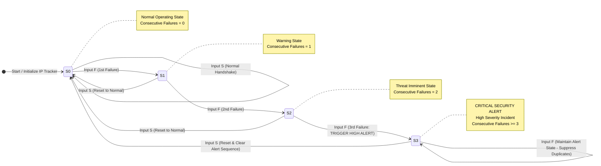

# Finite State Machine (FSM) State Transition Diagram

## Academic Project: Network Event Log Analyzer

### 1. Formal Automata Theory Definition

The intrusion detection sub-system is modeled as a Deterministic Finite Automaton (DFA):

$$M = (Q, \Sigma, \delta, q_0, F)$$

Where:
- **$Q$ (Finite Set of States):** $\{ S_0, S_1, S_2, S_3 \}$
  - $S_0$: Normal State (0 consecutive failures)
  - $S_1$: First Failure Detected (1 consecutive failure)
  - $S_2$: Second Failure Detected (2 consecutive failures)
  - $S_3$: Security Alert State (3 or more consecutive failures)
- **$\Sigma$ (Input Alphabet):** $\{ F, S \}$
  - $F$: Failed network connection attempt (`STATUS=FAILED`)
  - $S$: Successful network connection attempt (`STATUS=SUCCESS`)
- **$q_0$ (Start / Initial State):** $S_0$
- **$F$ (Set of Accepting / Alert States):** $\{ S_3 \}$
- **$\delta$ (Transition Function):** $Q \times \Sigma \to Q$

---

### 2. State Transition Diagram (Mermaid)

---

### 3. Transition Logic & Real-World Network Security Mapping

| Source State | Input Event | Target State | Automata Action | Security Implication |
| :--- | :---: | :--- | :--- | :--- |
| **S0 (Normal)** | `F` | **S1** | `RECORD_FIRST_FAILURE` | An initial failed connection is logged. Could be benign (typo in credentials). |
| **S0 (Normal)** | `S` | **S0** | `MAINTAIN_NORMAL` | Authenticated handshake. IP remains in trusted normal state. |
| **S1 (1 Failure)** | `F` | **S2** | `RECORD_SECOND_FAILURE` | Second consecutive failure from the same IP. Threat level elevates. |
| **S1 (1 Failure)** | `S` | **S0** | `RESET_TO_NORMAL` | Successful login resets the failure counter for this IP to 0. |
| **S2 (2 Failures)** | `F` | **S3** | `TRIGGER_SECURITY_ALERT` | **Threshold Met:** Exactly 3 consecutive failures. Generates a HIGH severity security alert for suspected brute-force attack. |
| **S2 (2 Failures)** | `S` | **S0** | `RESET_TO_NORMAL` | User successfully authenticated on 3rd try. Counter resets to S0. |
| **S3 (Alert State)** | `F` | **S3** | `MAINTAIN_ALERT_STATE` | Additional failures during an ongoing attack remain in S3 without spamming duplicate alerts. |
| **S3 (Alert State)** | `S` | **S0** | `RESET_ALERT_STATE` | Valid connection terminates the alert sequence, returning the IP to S0. |
